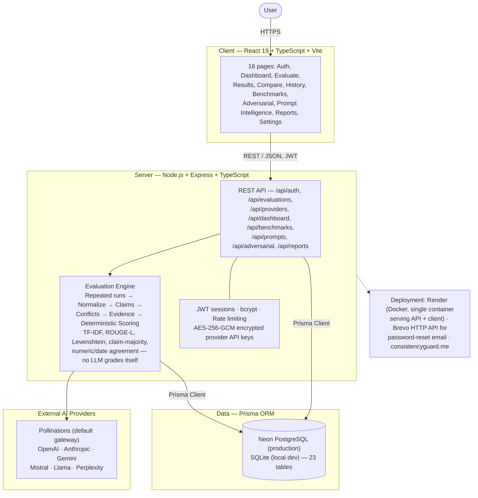

# Consistency Guard — "Evaluate. Compare. Trust AI."

AI reliability evaluation platform. Measures consistency, reliability, agreement,
conflicts, evidence support, and uncertainty across multiple AI models — not a
"which AI is best" leaderboard.

## Production deploy (permanent live link)

See **[DEPLOY.md](DEPLOY.md)** — one-command deploys for Render, Railway, or any
VPS with Docker. The image serves the API + client from a single container with
Postgres; migrations run automatically on boot.

There is no demo mode in production: register an account, add your own provider
keys (Pollinations `sk_` recommended for free onboarding), and evaluate.

## Local development

```bash
# 1. Backend
cd server
cp ../.env.example .env   # fill JWT_SECRET and ENCRYPTION_KEY
npm install
npx prisma generate
npx prisma db push
npm run seed              # local dev data (refuses to run in production)
npm run dev               # http://localhost:4000

# 2. Frontend (new terminal)
cd client
npm install
npm run dev               # http://localhost:5173 (or preview on :5199)
```

Local dev login (after `npm run seed`): `demo@consistency.guard` / `Demo123!@`

## Architecture

Full details, evaluation flow and design decisions: **[docs/architecture.md](docs/architecture.md)**



```
client/  React 19 + TS + Vite + Tailwind + StyleX + React Router + TanStack Query + Recharts
server/  Node + TS + Express + Prisma — Postgres in production, SQLite locally
         Evaluation modes: quick / consistency / deep / adversarial
```

## Key routes

`/login` `/register` `/forgot-password` `/evaluate/models`
`/evaluate/question` `/evaluate/running` `/evaluate/:id/results`
`/compare` `/dashboard` `/history` `/benchmarks` `/benchmarks/upload`
`/prompt-intelligence` `/adversarial` `/reports` `/settings`

## Security

- API keys encrypted at rest (AES-256-GCM), masked in UI (`sk-••••ab12`),
  decrypted only server-side, never logged or returned in full.
- Passwords hashed with bcrypt (12 rounds), lockout after 5 failed attempts.
- Keys are never in frontend source, localStorage, or logs.

## Methodology note

Ground-Truth Accuracy is reported only when reference answers exist.
Otherwise results are labeled **Cross-Model / Evidence-Based Reliability
Analysis** (consistency, evidence support, semantic agreement, grounding) —
never presented as absolute factual accuracy.
